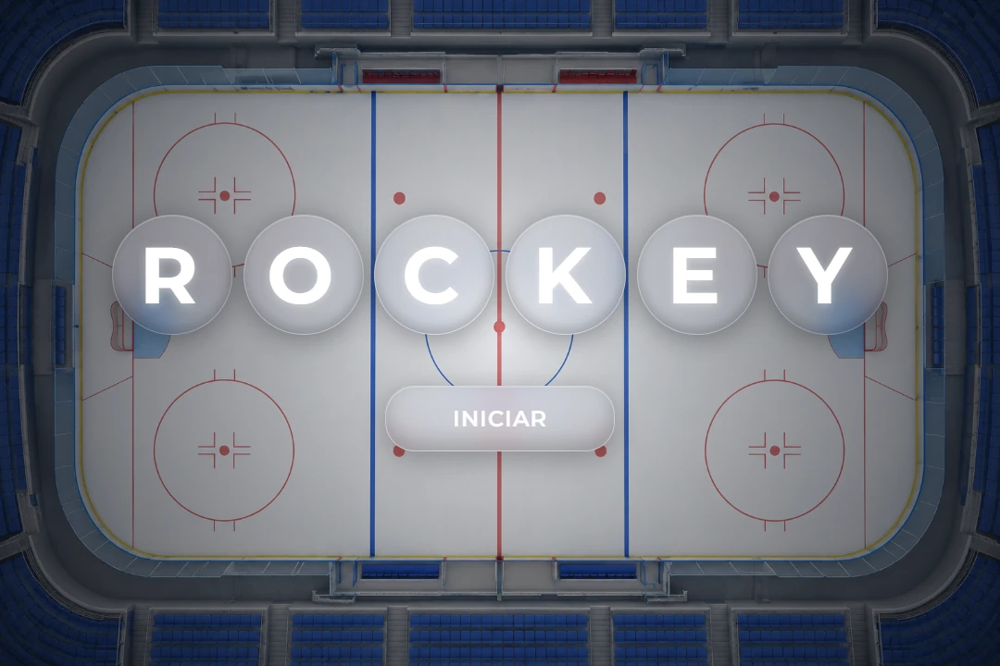
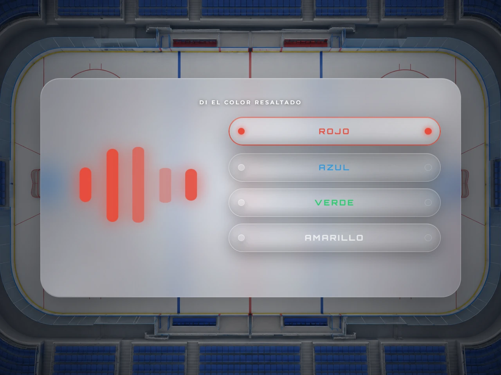
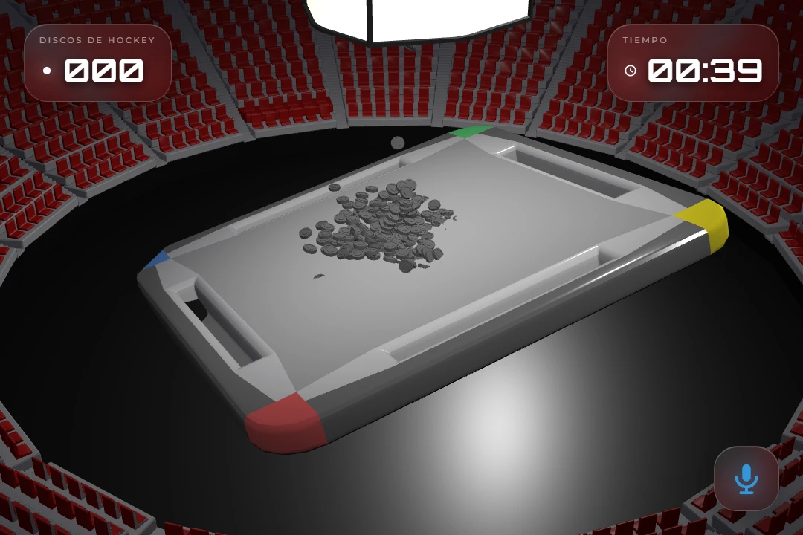
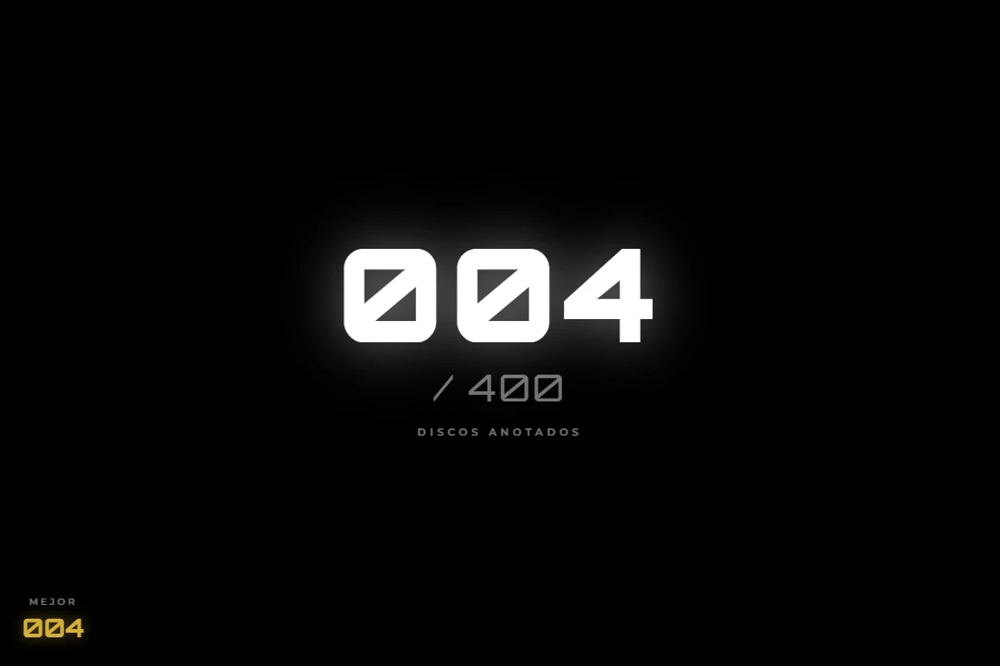

# Rockey

Rockey es un juego de física en 3D que se controla con la voz. En una arena, 400 piezas caen sobre una plataforma suspendida. El jugador tiene 60 segundos para inclinar la plataforma y guiar las piezas hacia las ranuras y sumar puntos. Cada uno de los cuatro colores —rojo, azul, verde y amarillo— inclina la plataforma en una dirección distinta.

<p align="center"><a href="docs/bienvenida.webp"></a></p>

## Del micrófono a la plataforma

Al iniciar, el juego pide permiso para usar el micrófono. La calibración guía al jugador por los cuatro colores antes de empezar la ronda. Durante la partida, repetir un color aumenta la inclinación en esa dirección. Al guardar silencio, la plataforma vuelve hacia el centro.

<p align="center">
  <a href="docs/calibracion.webp"></a>
  <a href="docs/inclinacion.webp"></a>
</p>

Al finalizar la ronda, el juego presenta los discos anotados y la mejor puntuación de la sesión.

<p align="center"><a href="docs/resultado.webp"></a></p>

## Ejecutar una copia local

Con Node.js 22 y npm, ejecuta desde la raíz:

```sh
npm ci
npm run dev
```

Abre la dirección de localhost que indique Vite en un navegador con WebGL y micrófono. Para servir el juego en otro equipo o dispositivo, usa HTTPS para que el navegador permita capturar audio. Para preparar y revisar la versión de producción, ejecuta `npm run build` y luego `npm run preview`.

El [modelo español Vosk Small ES 0.42](public/models/vosk-model-small-es-0.42.tar.gz) viene incluido en el repositorio. Al iniciar el reconocimiento por primera vez, el navegador carga unos 40 MB desde el propio sitio. Vosk procesa el audio en el dispositivo. La configuración predeterminada funciona sin claves de API ni archivo `.env`. El archivo original de [Alpha Cephei](https://alphacephei.com/vosk/models/vosk-model-small-es-0.42.zip) se reempaquetó con la carpeta interna `model/` para `vosk-browser`. [Licencia del modelo](public/models/LICENSE-vosk.txt).

## Cómo está construido

| Parte | Implementación |
| --- | --- |
| Escena y física | Babylon.js carga los modelos GLB de la arena, la plataforma y las piezas. Cannon.js, mediante `cannon-es`, simula los cuerpos. La lógica de [puntuación](src/pellets/) detecta qué piezas atraviesan las ranuras. |
| Voz | Un [AudioWorklet](public/audio-worklet.js) recoge muestras del micrófono a 16 kHz. El [motor Vosk](src/voice/VoskEngine.ts) reconoce un vocabulario limitado a los colores y traduce los resultados en órdenes para la plataforma. |
| Flujo del juego | [GameManager](src/game/GameManager.ts) coordina la calibración, la caída de las piezas, el cronómetro y el resultado. Los tiempos, inclinaciones y parámetros de la simulación están en [config.ts](src/config.ts). |
| Herramientas | TypeScript y Vite para desarrollo y compilación. Los modelos, texturas y efectos de sonido se sirven desde [public/](public/). |

## Colaboradores

- Dilan Jobany Garces Ortega
- Simón Paipa
- David Alvarado
